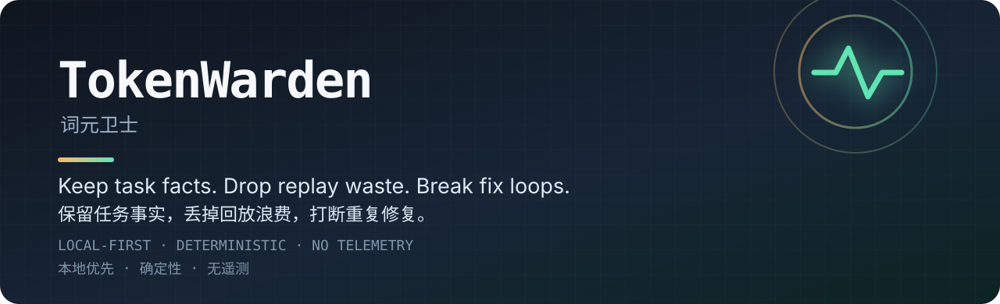
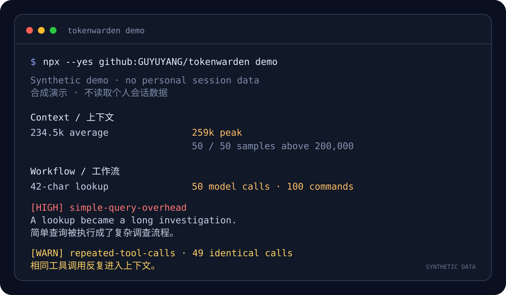
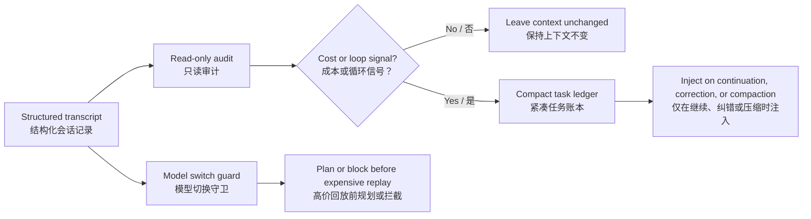

# TokenWarden — 词元卫士

**A context and cost guard for long-running AI coding agents.**
**面向长会话 AI 编程代理的上下文与成本守卫。**
Keep durable task facts. Drop replay waste. Find the loops that make agents expensive.
保留真正需要的事实，丢掉重复回放的浪费，找出让代理变慢、变贵的循环。

[](https://github.com/GUYUYANG/tokenwarden/actions/workflows/ci.yml)
[](LICENSE)
[](https://nodejs.org/)
[](#privacy-and-safety--隐私与安全)



> Your agent is not necessarily slow because the model thinks too much. It may be slow because every step carries a history nobody still needs.
> 代理变慢，不一定是因为模型想得太多；也可能是每一步都在重新携带已经不再需要的历史。

## See the failure in 15 seconds / 15 秒看见问题



No personal session, no Hook installation, and no telemetry. The command generates a temporary synthetic transcript and runs the real audit code against it.
不需要个人会话、不安装 Hook、不发送遥测。命令会生成临时合成会话，并用真实审计代码分析它。

```bash
npx --yes github:GUYUYANG/tokenwarden demo
```

The actual report includes / 实际报告包含：

```text
[HIGH] simple-query-overhead
初始请求仅 42 字符；首次真实修改工具前已产生 50 次模型调用和 100 个命令事件。

[WARN] repeated-tool-calls
发现 49 次完全相同的重复工具调用。
```

The model did not get “dumber.” The session hid the evidence and repeated the work.
模型没有突然“变笨”；是长会话藏起了证据，又把同一份工作重复了一遍。

## Audit your own session / 审计自己的会话

Run the read-only audit first. It prints structured telemetry, not prompts, assistant text, reasoning, tool arguments, or raw tool output.
先运行只读审计。它只输出结构化遥测，不输出提示词、助手正文、推理、工具参数或原始工具输出。

```bash
SESSION_ID=your-session-id
npx --yes github:GUYUYANG/tokenwarden audit "$SESSION_ID" --threshold 200000
```

Install the Codex Hooks only after the audit is useful to you:
只有审计结果对你有用后，再安装 Codex Hooks：

```bash
npm install --global github:GUYUYANG/tokenwarden
tokenwarden install
```

Open `/hooks` in Codex, review the exact commands, and trust them. Remove only TokenWarden hooks with `tokenwarden uninstall`.
在 Codex 中打开 `/hooks`，审核实际命令后选择信任。运行 `tokenwarden uninstall` 只会移除 TokenWarden 的 Hooks。

Prefer source? / 想直接看源码：

```bash
git clone https://github.com/GUYUYANG/tokenwarden.git
cd tokenwarden
npm run demo
npm test
```

AI coding sessions are not billed and delayed by the final answer alone. They are shaped by:
AI 编程会话的费用和延迟不只由最后一段回答决定，而主要受到以下关系影响：

```text
cost / latency pressure ≈ model calls × active context × unit price
成本 / 延迟压力 ≈ 模型调用次数 × 当前上下文 × 单价
```

Two hidden multipliers show up in long sessions:
长会话里通常会出现两个被忽视的放大器：

1. **Replay waste / 回放浪费** — stale reasoning, repeated tool output, and oversized context are sent again on every turn.
   历史思考、重复工具输出和过大的上下文会在每一步再次发送。
2. **Loop waste / 循环浪费** — the agent retries the same diagnosis, touches the same files, or repeats the same failed fix without new evidence.
   代理重复同一种诊断、反复修改同一批文件，或者在没有新证据时继续提交同一种失败修复。

TokenWarden is a small, local-first toolkit for making both visible and controllable. It does not call an LLM to police another LLM. It uses deterministic rules, structured telemetry, and host adapters.
TokenWarden 是一个小型、本地优先的工具包，用来让这两类浪费可观察、可控制。它不会调用另一个 LLM 来“监督”当前 LLM，而是使用确定性规则、结构化遥测和宿主适配器。

## Why it exists / 使用背景与为什么需要它

A normal context compressor preserves *text*. A coding session also needs to preserve *epistemic state*:
普通的上下文压缩器保存的是**文本**，而编程会话还必须保存**认知状态**：

- what the user has confirmed;
  用户已经确认什么；
- which hypotheses were ruled out;
  哪些假设已经被排除；
- what acceptance checks are still failing;
  哪些验收条件仍然失败；
- what verification actually ran.
  实际运行过哪些验证。

When a summary loses that hierarchy, an old assumption can return as if it were a fact. The agent looks “less intelligent” even when the model never changed. TokenWarden keeps a compact task ledger outside the transcript and restores it only when continuity is useful.
摘要一旦丢失这些优先级，旧假设就可能重新变成“事实”。即使模型没有更换，代理也会表现得像突然“降智”。TokenWarden 在会话记录之外保存紧凑任务账本，只在需要保持连续性时恢复它。

## What is included / 包含什么

| Capability / 能力 | What it answers / 解决的问题 | Code / 位置 |
| --- | --- | --- |
| **Session audit / 会话审计** | Where did calls, tokens, repeated output, and context pressure go?<br>调用、token、重复输出和上下文压力到底去了哪里？ | `tools/codex-session-audit.mjs` |
| **Durable task memory / 持久任务记忆** | What must survive compaction without replaying the whole session?<br>压缩后必须保留什么，同时不必回放整段会话？ | `tools/codex-task-memory.mjs` |
| **Loop breaker / 重复失败熔断** | Did the same failing outcome continue after repeated patches?<br>重复补丁后，同一个失败结果是否仍在继续？ | Included in task memory<br>内置于任务记忆 |
| **Model-switch budget / 模型切换预算** | Is switching to a more expensive model at the current context size wasteful?<br>在当前上下文规模下，切换到更贵的模型是否浪费？ | `tools/codex-model-switch-guard.mjs` |
| **Codex Hook installers / Codex Hook 安装器** | How do I wire this into a local Codex setup?<br>怎样接入本地 Codex 环境？ | `tools/install-codex-*.mjs` |
| **DSH adapter / DSH 适配器** | How do I reuse the same principles in a DSH host?<br>怎样在 DSH 宿主中复用相同原则？ | `adapters/dsh/` |

The audit and ledger are host-neutral in design. Codex and DSH are the first adapters, not a claim that every agent runtime exposes the same events.
审计器和任务账本在设计上保持宿主中立。Codex 与 DSH 只是首批适配器，并不代表每个代理运行时都会暴露相同事件。

## Install the Codex hooks / 安装 Codex Hooks

Requirements: Node.js 22.15 or newer. Review the scripts before running them.
要求：Node.js 22.15 或更新版本。运行脚本前请先审核代码。

```bash
tokenwarden install
```

Both installers are idempotent and merge into `~/.codex/hooks.json` instead of replacing unrelated hooks. Existing files are backed up before a successful write.
两个安装器都可重复运行，只会合并到 `~/.codex/hooks.json`，不会替换无关 Hooks；成功写入前会先备份现有文件。

After installation, open `/hooks` in Codex, review the changed commands, and trust them. A new session is required before new Hook configuration can be observed.
安装后，在 Codex 中打开 `/hooks`，逐条审核变更后的命令并选择信任。New Hook 配置需要在新会话中才能被观察到。

To remove only TokenWarden hooks:
只移除 TokenWarden 添加的 Hooks：

```bash
tokenwarden uninstall
```

See [Deployment / 部署](docs/DEPLOYMENT.md) for environment variables, rollback, and the DSH adapter.
环境变量、回滚方式和 DSH 适配器说明见[部署文档](docs/DEPLOYMENT.md)。

## How it works / 最大原理与工作流



The key rule is **facts over summaries**:
核心规则是**事实优先于摘要**：

```text
user-confirmed fact > observed runtime evidence > assistant inference
用户确认事实 > 实时运行证据 > 助手推断
```

An assistant hypothesis that the user has rejected remains rejected until new evidence changes it. After the same acceptance check fails twice, the guard requires a falsifiable new hypothesis and fresh runtime evidence instead of another similar patch.
用户已否定的助手假设会持续保持否定状态，直到新证据改变结论。同一个验收连续失败两次后，守卫会要求提出可证伪的新假设并采集新的运行证据，不再允许继续提交相似补丁。

## Design principles / 设计原则

- **Measure first. / 先测量。** Audit structured usage before changing thresholds.
  修改阈值前，先审计结构化用量。
- **No model-in-the-loop tax. / 不增加模型在环成本。** Rules are deterministic and local.
  规则在本机确定性执行。
- **Restore facts, not the whole past. / 恢复事实，不回放整段过去。** Long transcripts stay on disk; only a bounded ledger is injected.
  长会话仍保存在磁盘，只注入有长度上限的任务账本。
- **Prefer evidence to confidence. / 证据优先于自信。** “Implemented” is not “verified.”
  “已实现”不等于“已验证”。
- **Degrade safely. / 安全降级。** Unknown pricing, missing telemetry, or an unreadable Hook config must not silently corrupt state.
  未知价格、缺失遥测或无法读取的 Hook 配置都不能静默破坏状态。
- **Keep host assumptions explicit. / 明确宿主假设。** Event names and hook schemas belong in adapters.
  事件名和 Hook 协议应留在适配器层。

Read [Architecture / 架构](docs/ARCHITECTURE.md) and [Iteration principles / 迭代原则](docs/ITERATIONS.md) for the details.
详细说明见[架构文档](docs/ARCHITECTURE.md)和[迭代原则](docs/ITERATIONS.md)。

## Privacy and safety / 隐私与安全

- No telemetry service and no outbound analytics.
  不连接遥测服务，也不发送外部分析数据。
- The audit prints usage, counts, model names, file paths, and tool metadata. It does not print prompts, assistant text, reasoning text, tool arguments, or raw tool output.
  审计器只输出用量、计数、模型名、文件路径和工具元数据，不输出提示词、助手正文、推理正文、工具参数或原始工具输出。
- Task memory stores compact user statements, confirmed facts, rejected hypotheses, acceptance state, file paths, and verification summaries under `~/.codex/tokenwarden/`.
  任务记忆在 `~/.codex/tokenwarden/` 下保存精简用户陈述、确认事实、已否定假设、验收状态、文件路径和验证摘要。
- Raw reasoning, screenshots, and full tool output are not copied into the ledger.
  原始推理、截图和完整工具输出不会被复制进任务账本。
- Hooks run with your local permissions. Inspect the installer and Hook command before trusting it.
  Hooks 以本机权限运行；信任前请检查安装器和最终 Hook 命令。

Audit JSON can still contain a working directory and session path. Sanitize it before posting publicly. See [SECURITY.md / 安全说明](SECURITY.md).
审计 JSON 仍可能包含工作目录和会话路径；公开发布前必须脱敏。详见[安全说明](SECURITY.md)。

## When not to use it / 什么情况下不适用

- Your host does not expose structured usage or hook events.
  宿主不提供结构化用量或 Hook 事件。
- You need a hosted dashboard rather than local CLI output.
  你需要云端仪表盘，而不是本地 CLI 输出。
- You want a model to semantically rewrite all context. TokenWarden deliberately avoids that extra model call.
  你希望由模型语义重写全部上下文；TokenWarden 会刻意避免这次额外模型调用。
- You need a universal price blocker. Model-switch detection only activates when both models have known pricing.
  你需要适用于所有模型的绝对价格拦截；模型切换检测只在两个模型价格都已知时启用。

## Contributing / 参与贡献

The most useful contributions are reproducible audit patterns, host adapters, and tests that encode an observed failure mode without including personal data. Start with [CONTRIBUTING.md / 贡献指南](CONTRIBUTING.md).
最有价值的贡献是可复现的审计模式、新宿主适配器，以及不包含个人数据的失败场景测试。请先阅读[贡献指南](CONTRIBUTING.md)。

The complete Chinese-only guide remains available at [README.zh-CN.md / 中文说明](README.zh-CN.md).
如果需要纯中文速览，可继续阅读[中文说明](README.zh-CN.md)。

## License / 许可证

This project is licensed under **GPL-3.0-only**. You may use, modify, and redistribute it under the GNU GPLv3 terms. If you distribute a modified version, the GPL source-sharing obligations apply.
本项目采用 **GPL-3.0-only** 许可证。你可以依照 GNU GPLv3 条款使用、修改和再分发。分发修改版时，必须遵守 GPL 的源码开放义务。

See [LICENSE](LICENSE) for the complete license text.
完整许可证文本见 [LICENSE](LICENSE)。
