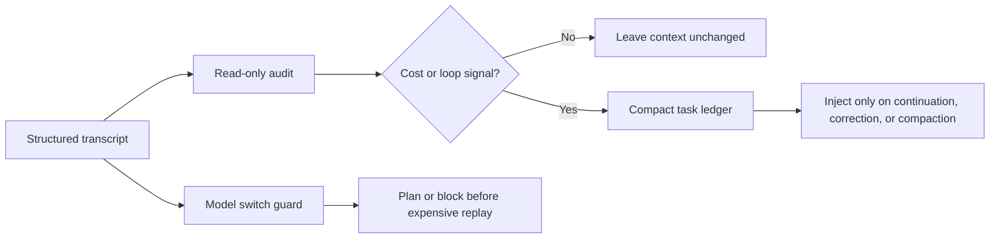

# TokenWarden — 词元卫士

**A context and cost guard for long-running AI coding agents.**  
Keep durable task facts. Drop replay waste. Find the loops that make agents expensive.

[](https://github.com/GUYUYANG/tokenwarden/actions/workflows/ci.yml)
[](LICENSE)
[](https://nodejs.org/)
[](#privacy-and-safety)


> Your agent is not necessarily slow because the model thinks too much. It may be slow because every step carries a history nobody still needs.

AI coding sessions are not billed and delayed by the final answer alone. They are shaped by:

```text
cost / latency pressure ≈ model calls × active context × unit price
```

Two hidden multipliers show up in long sessions:

1. **Replay waste** — stale reasoning, repeated tool output, and oversized context are sent again on every turn.
2. **Loop waste** — the agent retries the same diagnosis, touches the same files, or repeats the same failed fix without new evidence.

TokenWarden is a small, local-first toolkit for making both visible and controllable. It does not call an LLM to police another LLM. It uses deterministic rules, structured telemetry, and host adapters.

## Why it exists

A normal context compressor preserves *text*. A coding session also needs to preserve *epistemic state*:

- what the user has confirmed;
- which hypotheses were ruled out;
- what acceptance checks are still failing;
- what verification actually ran.

When a summary loses that hierarchy, an old assumption can return as if it were a fact. The agent looks “less intelligent” even when the model never changed. TokenWarden keeps a compact task ledger outside the transcript and restores it only when continuity is useful.

## What is included

| Capability | What it answers | Code |
| --- | --- | --- |
| **Session audit** | Where did calls, tokens, repeated output, and context pressure go? | `tools/codex-session-audit.mjs` |
| **Durable task memory** | What must survive compaction without replaying the whole session? | `tools/codex-task-memory.mjs` |
| **Loop breaker** | Did the same failing outcome continue after repeated patches? | Included in task memory |
| **Model-switch budget** | Is switching to a more expensive model at the current context size wasteful? | `tools/codex-model-switch-guard.mjs` |
| **Codex Hook installers** | How do I wire this into a local Codex setup? | `tools/install-codex-*.mjs` |
| **DSH adapter** | How do I reuse the same principles in a DSH host? | `adapters/dsh/` |

The audit and ledger are host-neutral in design. Codex and DSH are the first adapters, not a claim that every agent runtime exposes the same events.

## 60-second quick start

```bash
git clone https://github.com/GUYUYANG/tokenwarden.git
cd tokenwarden
npm test
node tools/codex-session-audit.mjs <session-id> --threshold 200000
```

The audit is read-only and prints structured telemetry rather than prompting you to paste an entire conversation.

Typical findings look like this:

```text
context-replay          many calls above the configured context threshold
repeated-tool-calls     identical tool calls re-entering the context
simple-query-overhead   a short lookup expanded into a long investigation loop
frequent-compaction     repeated summarization and context reconstruction
```

## Install the Codex hooks

Requirements: Node.js 22.15 or newer. Review the scripts before running them.

```bash
node tools/install-codex-task-memory.mjs
node tools/install-codex-model-switch-guard.mjs
```

Both installers are idempotent and merge into `~/.codex/hooks.json` instead of replacing unrelated hooks. Existing files are backed up before a successful write.

After installation, open `/hooks` in Codex, review the changed commands, and trust them. A new session is required before new Hook configuration can be observed.

To remove only TokenWarden hooks:

```bash
node tools/uninstall-codex-hooks.mjs
```

See [Deployment](docs/DEPLOYMENT.md) for environment variables, rollback, and the DSH adapter.

## How it works



The key rule is **facts over summaries**:

```text
user-confirmed fact > observed runtime evidence > assistant inference
```

An assistant hypothesis that the user has rejected remains rejected until new evidence changes it. After the same acceptance check fails twice, the guard requires a falsifiable new hypothesis and fresh runtime evidence instead of another similar patch.

## Design principles

- **Measure first.** Audit structured usage before changing thresholds.
- **No model-in-the-loop tax.** Rules are deterministic and local.
- **Restore facts, not the whole past.** Long transcripts stay on disk; only a bounded ledger is injected.
- **Prefer evidence to confidence.** “Implemented” is not “verified.”
- **Degrade safely.** Unknown pricing, missing telemetry, or an unreadable Hook config must not silently corrupt state.
- **Keep host assumptions explicit.** Event names and hook schemas belong in adapters.

Read [Architecture](docs/ARCHITECTURE.md) and [Iteration principles](docs/ITERATIONS.md) for the details.

## Privacy and safety

- No telemetry service and no outbound analytics.
- The audit prints usage, counts, model names, file paths, and tool metadata. It does not print prompts, assistant text, reasoning text, tool arguments, or raw tool output.
- Task memory stores compact user statements, confirmed facts, rejected hypotheses, acceptance state, file paths, and verification summaries under `~/.codex/tokenwarden/`.
- Raw reasoning, screenshots, and full tool output are not copied into the ledger.
- Hooks run with your local permissions. Inspect the installer and Hook command before trusting it.

Audit JSON can still contain a working directory and session path. Sanitize it before posting publicly. See [SECURITY.md](SECURITY.md).

## When not to use it

- Your host does not expose structured usage or hook events.
- You need a hosted dashboard rather than local CLI output.
- You want a model to semantically rewrite all context. TokenWarden deliberately avoids that extra model call.
- You need a universal price blocker. Model-switch detection only activates when both models have known pricing.

## Contributing

The most useful contributions are reproducible audit patterns, host adapters, and tests that encode an observed failure mode without including personal data. Start with [CONTRIBUTING.md](CONTRIBUTING.md).

中文使用说明见 [README.zh-CN.md](README.zh-CN.md)。

## License

MIT
