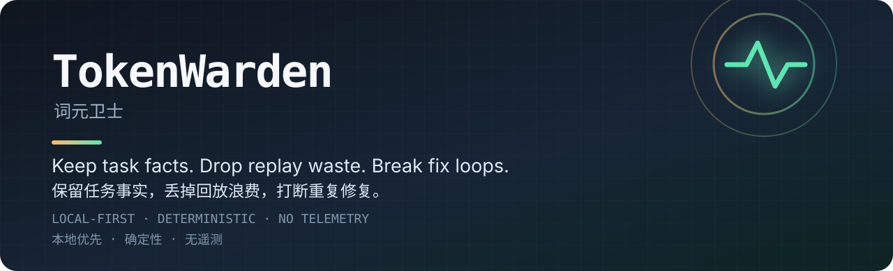

# TokenWarden — 词元卫士

**给长会话 AI 编程代理的上下文与成本守卫。**  
保留真正需要的事实，丢掉重复回放的浪费，找出让代理变慢变贵的循环。



你的代理变慢，不一定是因为模型想得更多。更常见的原因是：每一步都在重新携带已经不再需要的历史。

## 使用背景

AI 编程会话的开销和延迟，不只取决于最后一段回答，而近似受到三个因素共同影响：

```text
成本 / 延迟压力 ≈ 模型调用次数 × 当前上下文 × 单价
```

长会话里通常有两个被忽视的放大器：

1. **回放浪费**：历史思考、重复工具输出和过大的上下文在每一步再次发送。
2. **循环浪费**：同一个假设、同一个失败验收、同一类补丁被重复执行，却没有新证据。

TokenWarden 用本地、确定性的规则和结构化遥测，把这两类问题变成可观察、可验证、可回滚的工程问题。它不会调用第二个模型来“监督”第一个模型。

## 最大的原理

普通的上下文压缩保留文本，但编程任务还需要保留**认知状态**：

- 用户已经确认什么；
- 哪些假设已经被否定；
- 哪个验收条件仍然失败；
- 实际运行过哪些验证。

一旦摘要丢掉这些优先级，旧假设就会重新变成“事实”。模型没换，表现却会像突然降智。TokenWarden 在转录之外保存紧凑任务账本，只在继续同一问题、用户纠错或上下文压缩后注入。

优先级固定为：

```text
用户确认事实 > 实时观测证据 > 助手推断
```

同一个验收连续失败两次后，守卫要求提出可证伪的新假设并采集新的运行证据，不再允许继续提交相似补丁。

## 功能

| 能力 | 解决的问题 | 位置 |
| --- | --- | --- |
| 会话审计 | 调用、token、重复输出和上下文压力到底去了哪里 | `tools/codex-session-audit.mjs` |
| 持久任务记忆 | 压缩后恢复事实，而不是回放整段对话 | `tools/codex-task-memory.mjs` |
| 重复失败熔断 | 防止同一个失败方案被修很多遍 | 任务记忆内置 |
| 模型切换预算 | 大上下文切换到高价模型前先提醒或拦截 | `tools/codex-model-switch-guard.mjs` |
| Codex Hook 安装 | 合并到本地 Hooks，不覆盖无关配置 | `tools/install-codex-*.mjs` |
| DSH 适配器 | 复用相同原则到另一类宿主 | `adapters/dsh/` |

## 60 秒开始

要求 Node.js 22.15 或更新版本。

```bash
git clone https://github.com/GUYUYANG/tokenwarden.git
cd tokenwarden
npm test

# 只读审计；不会打印提示词、助手正文、reasoning 或完整工具输出
node tools/codex-session-audit.mjs <session-id> --threshold 200000
```

安装 Codex Hooks：

```bash
node tools/install-codex-task-memory.mjs
node tools/install-codex-model-switch-guard.mjs
```

安装器会先备份现有 `~/.codex/hooks.json`，再合并 Hook；重复运行不会叠加。执行后需要在 Codex 的 `/hooks` 中审核并信任，新会话才会加载变更。

只移除 TokenWarden 添加的 Hooks：

```bash
node tools/uninstall-codex-hooks.mjs
```

完整部署、环境变量和 DSH 适配说明见 [部署文档](docs/DEPLOYMENT.md) 与 [架构说明](docs/ARCHITECTURE.md)。

## 隐私边界

- 无遥测服务，无外部分析请求。
- 审计器只输出结构化用量、计数、模型、路径和工具元数据，不输出提示词、助手正文、推理和原始工具输出。
- 任务账本保存在本机 `~/.codex/tokenwarden/`，不包含截图、完整 reasoning 或完整工具结果。
- Hook 以本机权限运行。安装前应检查脚本和最终 Hook 命令。
- 审计 JSON 仍可能包含工作目录和会话路径，公开前必须脱敏。

## 适用与不适用

适用：有结构化会话记录或 Hook 事件的本地 AI 编程环境；需要控制长会话费用和重复劳动的个人或团队。

不适用：宿主完全不提供结构化事件；需要云端仪表盘；或希望通过另一个模型对全部上下文做语义改写。

## 迭代记录

项目只记录可泛化的工程原理，不记录具体用户任务或会话内容。参见 [ITERATIONS.md](docs/ITERATIONS.md)。

## 许可

本项目采用 **GPL-3.0-only** 许可证。你可以依照 GNU GPLv3 条款使用、修改和再分发；分发修改版时，必须遵守 GPL 的源码开放义务。

完整许可证文本见 [LICENSE](LICENSE)。
